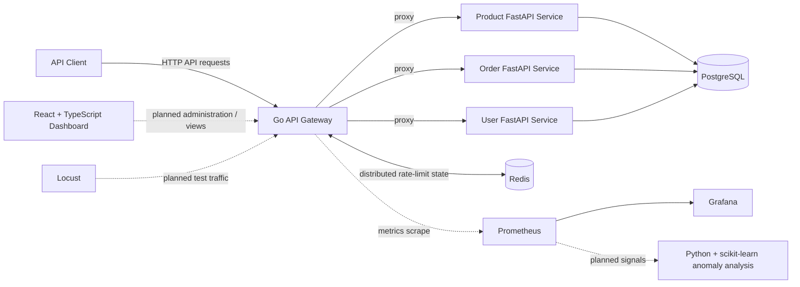
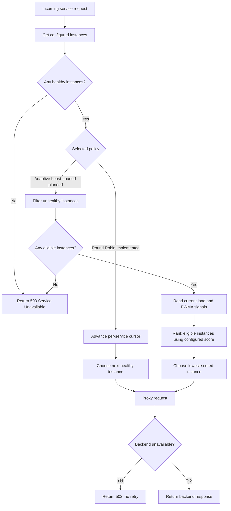
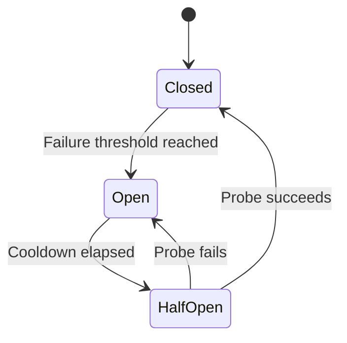

# IntelliGate Proposed Architecture

**Status:** Phase 1 implements the Go HTTP reverse proxy and three FastAPI services. Phase 2A adds per-service Round Robin pools; Phase 2B adds active health probes and selects only healthy instances. Authentication, rate limiting, adaptive routing, databases, monitoring, and the other integrations described below remain proposed.

## 1. High-level system architecture

The Go gateway is the public entry point for client API traffic. It proxies requests to configured Python FastAPI backend instances using Go's standard HTTP reverse-proxy capabilities and selects an instance round-robin from each service's healthy pool. Direct backend `/health` probes update eligibility. Future phases may add additional gateway policies and service-owned domain APIs. Redis is designated for distributed rate-limit state; PostgreSQL for persistent application data and selected configuration. Prometheus/Grafana, Locust, the dashboard, and anomaly-detection component remain planned.



**Status note:** Gateway-to-service HTTP connections, Round Robin selection, and active health checks across configured local backend pools are implemented. Redis, PostgreSQL, Prometheus, Grafana, Locust, dashboard, and anomaly-detection connections remain proposed. No containerized deployment is included.

### Phase 1/2B runtime configuration

| Component | Local address | Gateway route |
| --- | --- | --- |
| Gateway | `http://localhost:8080` | Entry point |
| Product Service | `http://localhost:8001` | `/api/v1/products` and descendants |
| Order Service | `http://localhost:8002` | `/api/v1/orders` and descendants |
| User Service | `http://localhost:8003` | `/api/v1/users` and descendants |

When the corresponding URL-list environment variable is unset, the gateway defaults to one backend per service at the listed address. Configure multiple backends using comma-separated full URLs in `PRODUCT_SERVICE_URLS`, `ORDER_SERVICE_URLS`, and `USER_SERVICE_URLS`. Additional port values are chosen by the local operator; the table shows existing defaults, not a required multi-instance port layout. The gateway keeps the incoming path and query string unchanged when proxying. Each service also exposes `GET /` and `GET /health` directly on its local port.

The gateway probes each configured backend's `/health` directly with GET requests every 5 seconds and a 2-second timeout. Initial probes run concurrently and complete before the gateway begins serving. Only direct 2xx responses count as healthy; redirects are not followed. An unavailable backend can continue to receive traffic until a subsequent failed probe completes.

## 2. Component responsibilities

### Gateway (Go)

Beyond the Phase 1 behavior below, the gateway is planned to:

- Expose a public HTTP entry point and statically route the three service prefixes (implemented).
- Log each request method and path, without query parameters (implemented).
- Return `404 Not Found` for unmatched paths, `503 Service Unavailable` when all instances are unhealthy, and `502 Bad Gateway` when a selected backend cannot be reached (implemented).
- Authenticate protected clients and apply per-client rate limits.
- Select a configured backend instance round-robin within each service pool (implemented in Phase 2A).
- Probe backend health and select only healthy instances (implemented in Phase 2B).
- Select instances using an adaptive policy (planned; not implemented).
- Reverse-proxy requests and responses with appropriate timeouts and error handling.
- Gather latency, request, health, and circuit-breaker metrics.
- Expose gateway `GET /health` (implemented); readiness and Prometheus metrics endpoints remain planned.
- Exclude unhealthy instances and restore them after a successful probe (implemented in Phase 2B).

The `proxy`, `router`, `balancer`, and `health` packages under `gateway/internal/` are implemented. The `middleware`, `circuitbreaker`, and `metrics` directories remain planned boundaries.

### Backend microservices (Python + FastAPI)

- **Product Service:** Sample catalog GET endpoint implemented; broader catalog operations remain planned.
- **Order Service:** Sample orders GET endpoint implemented; order creation and retrieval remain planned.
- **User Service:** Sample users GET endpoint implemented; profile operations remain planned.

Each service will own its domain API. Service-level validation and persistence details remain to be designed with implementation. Backend services are not intended to replace gateway authentication and traffic policy.

### Redis and PostgreSQL

- **Redis:** Shared, short-lived state for distributed token bucket rate limiting. It is not the system of record.
- **PostgreSQL:** Persistent application records and selected gateway/service configuration. Configuration ownership, schema, and migrations remain implementation decisions.

### Monitoring and supporting tools

- **Prometheus:** Scrape and retain gateway metrics.
- **Grafana:** Visualize Prometheus metrics through dashboards.
- **Locust:** Generate controlled, repeatable workloads.
- **React + TypeScript + Tailwind CSS:** Planned dashboard interface.
- **Python + scikit-learn:** Planned offline or otherwise explicitly scoped analysis of traffic signals; real-time integration is not yet decided.

## 3. Request lifecycle

The Phase 2B application request path is:

1. Receive an HTTP request at port 8080.
2. Match the request path to one of the three service prefixes; return 404 if none matches.
3. Select the next healthy configured instance for that service under a short mutex lock; return 503 if none is healthy.
4. Proxy the request with its original path and query; return 502 if the selected backend is unreachable.
5. Log the method and path without query parameters.

Separately, the health checker probes every configured instance directly at `/health`. The gateway marks all instances unhealthy before the first probe cycle, completes that cycle before accepting application traffic, then starts periodic checks. Probe status changes update the corresponding selector; later successful probes restore eligibility.

The following extended path remains proposed:

1. Handle gateway health/readiness/metrics paths separately from protected service routes.
2. Validate request metadata, authenticate protected clients, and apply the client's distributed rate limit.
3. Obtain healthy backends, select an instance using the configured adaptive policy, and proxy the request.
4. Record request outcome, latency, health, and circuit-breaker signals.

No application retry policy or explicit upstream timeout is configured. Additional middleware, error schemas, and timeout policy remain to be defined. Automatic retries are not assumed.

```mermaid
sequenceDiagram
    participant C as Client
    participant G as Go Gateway
    participant R as Redis (planned)
    participant LB as Backend Pool / Router
    participant S as FastAPI Service (planned)
    participant P as Prometheus (planned)
    C->>G: Request
    G->>G: Match route; bypass policy only for designated public endpoints
    G->>G: Validate API key for protected route
    G->>R: Consume client token
    R-->>G: Allowed or rate limited
    G->>LB: Select healthy instance (Round Robin implemented)
    LB-->>G: Selected backend
    G->>S: Proxy request
    S-->>G: Response
    G->>G: Record outcome and latency; update routing signals
    G-->>C: Response
    P->>G: Scrape metrics endpoint
```

The diagram represents intended later-phase interactions except for service-route matching, HTTP proxying, per-service Round Robin selection, and active health checking, which are implemented. A failed health probe marks its backend unhealthy; the gateway does not retry application requests. An application proxy failure between probes returns 502 until the next health update.

## 4. API key authentication flow

Protected service requests are planned to carry a client API key in the `X-API-Key` header over TLS in deployed environments. The gateway will validate the key against an approved source, associate it with a client identity and rate-limit policy, and reject missing or invalid credentials before proxying. Key storage, hashing/rotation, provisioning, revocation, and administrative authorization must be specified before implementation. Secrets must not be stored in source control. Health/readiness and metrics access policy will be explicitly defined rather than inferred from the diagram.

## 5. Rate-limiting architecture

The planned policy is a token bucket per client, with Redis holding shared state so multiple gateway instances can enforce a common limit. Refill rate, bucket capacity, key strategy, atomic update mechanism, expiration, and behavior during Redis failure are open implementation decisions. The gateway will return a documented rate-limit response when a request exceeds the configured policy. Exact headers and status/body schema will be set with the API implementation.

## 6. Routing and load balancing

### Health-aware Round Robin (implemented in Phase 2B)

Each service has its own selector over its configured backend handler list and health flags. For each request, the selector locks briefly, scans from its cursor for the next healthy instance, advances after that selection, and unlocks before proxying. Health updates use the same mutex. If no instance is healthy, it returns `503 Service Unavailable`. The selector preserves the Phase 2A all-healthy constructor default; gateway initialization explicitly sets every instance unhealthy before probing.

The health checker sends direct GET requests to each backend's `/health` endpoint. It runs the initial probes concurrently before the HTTP server starts, then probes periodically every 5 seconds with a 2-second client timeout. Only 2xx responses are healthy; redirects are not followed. Connection failures, timeouts, and other status codes mark an instance unhealthy. The next successful probe restores it to the round-robin pool. Health is based only on probe outcomes, not ordinary application responses.

If a backend fails after its last successful probe, requests can still be selected for it until a later probe; the existing proxy returns 502. There are no retries or automatic failover. If all instances in a service pool are unhealthy, requests to that service return 503. Gateway `GET /health` remains a process liveness check and returns 200 regardless of backend health.

### Adaptive Least-Loaded

The adaptive policy will select an eligible instance using a measured load signal rather than fixed rotation. It should account for current in-flight requests and latency signals, while ensuring stale latency measurements do not unfairly penalize a backend indefinitely. The actual scoring formula, coefficients, and tie-breaking policy remain open implementation decisions for a later phase. Measurements must be collected consistently to avoid giving either policy an unfair advantage.



The diagram shows active-health filtering with the implemented Round Robin policy and a proposed adaptive policy. Circuit-breaker eligibility and adaptive scoring are not implemented.

## 7. EWMA latency tracking

The gateway is planned to maintain a per-instance exponentially weighted moving average of observed response latency. With a chosen smoothing factor `alpha` (where `0 < alpha <= 1`), a sample update is:

`EWMA_new = alpha * latency_sample + (1 - alpha) * EWMA_previous`

The initialization rule, alpha, treatment of timeouts/errors, observation window, and concurrency safety need to be specified and measured. EWMA is a routing signal, not a substitute for health state or a guarantee of future latency.

## 8. Health monitoring and recovery (implemented in Phase 2B)

The gateway actively probes each configured backend's `/health` endpoint using GET every 5 seconds, with a 2-second timeout and no redirect following. Initial probes run concurrently before application traffic is served. A direct HTTP 2xx response marks the instance healthy; connection errors, timeouts, redirects, and non-2xx statuses mark it unhealthy. Periodic successful probes restore eligibility. Probe outcomes—not application request statuses—control health. All-unhealthy service pools return 503; a backend failure between probes retains the existing 502 behavior. No hysteresis, retries, or health metrics are implemented.

## 9. Circuit breaker

The planned circuit breaker has Closed, Open, and Half-Open states. In Closed, traffic may flow while failures are counted. On a configured failure condition, the breaker opens and calls are rejected or routed elsewhere for a cooldown. After cooldown, a limited probe is allowed in Half-Open; success closes the breaker and failure reopens it. Thresholds, cooldowns, probe concurrency, and whether state is per instance or service must be selected and tested.



These are proposed transitions. No breaker state machine exists in Phase 0.

## 10. Prometheus and Grafana integration

The gateway is planned to expose a Prometheus scrape endpoint with bounded-cardinality metrics for request counts, status classes, latency, rate-limit decisions, backend health, and circuit-breaker state. Avoid labels containing API keys, user identifiers, raw URLs, or other unbounded/sensitive values. Prometheus will scrape the gateway; Grafana will visualize selected series. Scrape configuration, dashboards, retention, and alert rules are not yet present.

## 11. Traffic anomaly detection

A Python component using scikit-learn is planned to explore anomalies in aggregated traffic or latency signals. The input features, training data, model selection, evaluation criteria, deployment mode, and response to an alert are undecided. Anomaly detection will not be treated as an automated enforcement mechanism without validation and explicit design review.

## 12. Architectural decisions and open decisions

**Fixed decisions:** Go gateway; standard-library reverse-proxy capabilities; FastAPI services; per-service Round Robin across configured backend URLs; Redis-backed distributed rate-limit state; PostgreSQL for persistent records/configuration; Prometheus and Grafana; Locust; future comparison with Adaptive Least-Loaded.

**Open decisions:** Additional local backend port assignments; runtime pool reload; health flapping/hysteresis policy; routing score and EWMA parameters; circuit-breaker scope and thresholds; Redis failure mode; auth key lifecycle and admin authorization; metrics names and cardinality; dashboard interaction; anomaly model and operation mode.
