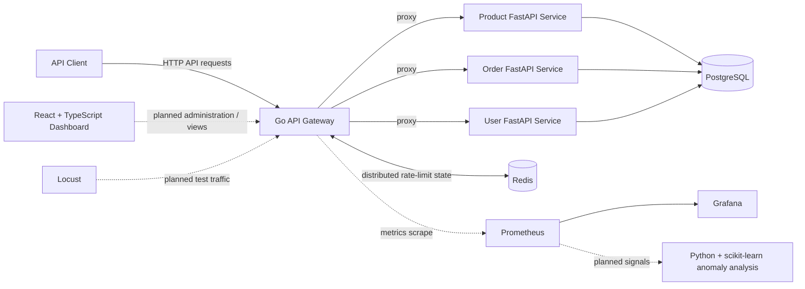
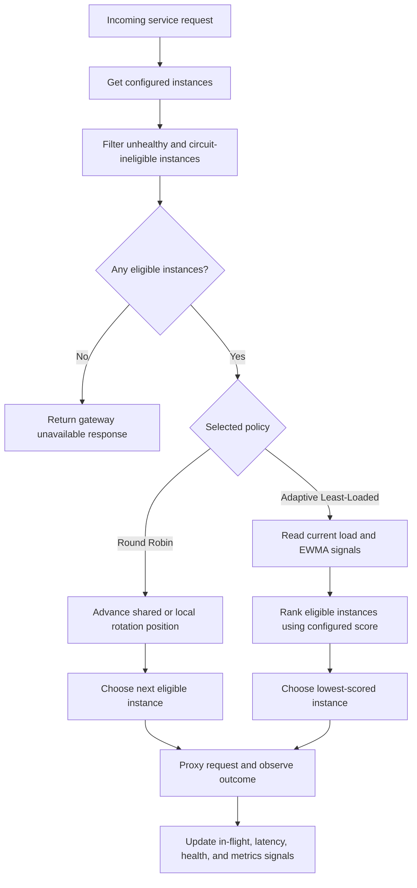
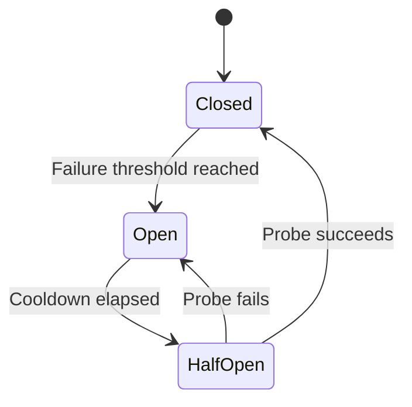

# IntelliGate Proposed Architecture

**Status:** This document describes the target design. At Phase 0, the directories and documentation are initialized; the runtime components and integrations below are **proposed, not implemented**.

## 1. High-level system architecture

The Go gateway will be the only public entry point for client API traffic. It will apply request policies and proxy service requests using Go's standard HTTP reverse-proxy capabilities. Python FastAPI services will own their respective domain APIs. Redis will hold distributed rate-limit state; PostgreSQL will hold persistent application data and selected configuration. Prometheus will scrape metrics, and Grafana will visualize them. Locust will generate workloads. The dashboard and anomaly-detection component are planned consumers of system data.



**Status note:** All runtime nodes and connections in this diagram are proposed. The diagram does not imply a deployed or operational system.

## 2. Component responsibilities

### Gateway (Go)

The gateway is planned to:

- Expose public HTTP endpoints and route service paths.
- Authenticate protected clients and apply per-client rate limits.
- Select eligible backend instances using the configured balancing policy.
- Reverse-proxy requests and responses with appropriate timeouts and error handling.
- Gather latency, request, health, and circuit-breaker metrics.
- Expose health, readiness, and Prometheus metrics endpoints.
- Exclude unhealthy or open-circuit instances and support controlled recovery.

The intended package boundaries are `proxy`, `router`, `middleware`, `health`, `circuitbreaker`, and `metrics` under `gateway/internal/`. These are planned boundaries, not implemented packages.

### Backend microservices (Python + FastAPI)

- **Product Service:** Planned product catalog operations.
- **Order Service:** Planned order creation and retrieval operations.
- **User Service:** Planned user profile operations.

Each service will own its domain API. Service-level validation and persistence details remain to be designed with implementation. Backend services are not intended to replace gateway authentication and traffic policy.

### Redis and PostgreSQL

- **Redis:** Shared, short-lived state for distributed token bucket rate limiting. It is not the system of record.
- **PostgreSQL:** Persistent application records and selected gateway/service configuration. Configuration ownership, schema, and migrations remain implementation decisions.

### Monitoring and supporting tools

- **Prometheus:** Scrape and retain gateway metrics.
- **Grafana:** Visualize Prometheus metrics through dashboards.
- **Locust:** Generate controlled, repeatable workloads.
- **React + TypeScript + Tailwind CSS:** Planned dashboard interface.
- **Python + scikit-learn:** Planned offline or otherwise explicitly scoped analysis of traffic signals; real-time integration is not yet decided.

## 3. Request lifecycle

The intended request path is:

1. Receive an HTTP request at the gateway.
2. Handle gateway health/readiness/metrics paths separately from protected service routes.
3. Resolve the service route and validate required request metadata.
4. Authenticate the client for protected routes.
5. Apply the client's distributed rate limit using Redis.
6. Obtain the eligible healthy backend set; exclude instances disallowed by health or circuit-breaker state.
7. Select an instance with the configured Round Robin or Adaptive Least-Loaded policy.
8. Proxy the request using Go's standard HTTP reverse-proxy capabilities, enforcing timeouts.
9. Record request outcome and latency; update EWMA and health/circuit-breaker signals as appropriate.
10. Return the backend response or a gateway error response.

The precise middleware order, error schema, timeout values, and retry policy must be defined and tested during implementation. Automatic retries are not assumed by this proposal.

```mermaid
sequenceDiagram
    participant C as Client
    participant G as Go Gateway (planned)
    participant R as Redis (planned)
    participant LB as Backend Pool / Router (planned)
    participant S as FastAPI Service (planned)
    participant P as Prometheus (planned)
    C->>G: Request
    G->>G: Match route; bypass policy only for designated public endpoints
    G->>G: Validate API key for protected route
    G->>R: Consume client token
    R-->>G: Allowed or rate limited
    G->>LB: Select healthy, circuit-eligible instance
    LB-->>G: Selected backend
    G->>S: Proxy request
    S-->>G: Response
    G->>G: Record outcome and latency; update routing signals
    G-->>C: Response
    P->>G: Scrape metrics endpoint
```

The diagram represents intended interactions, not verified behavior.

## 4. API key authentication flow

Protected service requests are planned to carry a client API key in the `X-API-Key` header over TLS in deployed environments. The gateway will validate the key against an approved source, associate it with a client identity and rate-limit policy, and reject missing or invalid credentials before proxying. Key storage, hashing/rotation, provisioning, revocation, and administrative authorization must be specified before implementation. Secrets must not be stored in source control. Health/readiness and metrics access policy will be explicitly defined rather than inferred from the diagram.

## 5. Rate-limiting architecture

The planned policy is a token bucket per client, with Redis holding shared state so multiple gateway instances can enforce a common limit. Refill rate, bucket capacity, key strategy, atomic update mechanism, expiration, and behavior during Redis failure are open implementation decisions. The gateway will return a documented rate-limit response when a request exceeds the configured policy. Exact headers and status/body schema will be set with the API implementation.

## 6. Routing and load balancing

### Round Robin baseline

The baseline will cycle over eligible backend instances for a service. Health and circuit-breaker eligibility will constrain the candidate set. The implementation must define behavior when the set is empty and when membership changes; no specific behavior is claimed as implemented.

### Adaptive Least-Loaded

The adaptive policy will select an eligible instance using a measured load signal rather than fixed rotation. It should account for current in-flight requests and latency signals, while ensuring stale latency measurements do not unfairly penalize a backend indefinitely. The actual scoring formula, coefficients, and tie-breaking policy remain open implementation decisions for Phase 2. Measurements must be collected consistently to avoid giving either policy an unfair advantage.



The empty-pool response and state synchronization approach are proposed behaviors requiring implementation and tests.

## 7. EWMA latency tracking

The gateway is planned to maintain a per-instance exponentially weighted moving average of observed response latency. With a chosen smoothing factor `alpha` (where `0 < alpha <= 1`), a sample update is:

`EWMA_new = alpha * latency_sample + (1 - alpha) * EWMA_previous`

The initialization rule, alpha, treatment of timeouts/errors, observation window, and concurrency safety need to be specified and measured. EWMA is a routing signal, not a substitute for health state or a guarantee of future latency.

## 8. Health monitoring and recovery

The gateway is planned to maintain backend health using configurable probes and/or observed request outcomes. Unhealthy instances will be omitted from routing until recovery criteria are satisfied. Probe path, cadence, thresholds, recovery hysteresis, and behavior during partial outages are implementation decisions. Health transitions should be observable through metrics without exposing sensitive data.

## 9. Circuit breaker

The planned circuit breaker has Closed, Open, and Half-Open states. In Closed, traffic may flow while failures are counted. On a configured failure condition, the breaker opens and calls are rejected or routed elsewhere for a cooldown. After cooldown, a limited probe is allowed in Half-Open; success closes the breaker and failure reopens it. Thresholds, cooldowns, probe concurrency, and whether state is per instance or service must be selected and tested.



These are proposed transitions. No breaker state machine exists in Phase 0.

## 10. Prometheus and Grafana integration

The gateway is planned to expose a Prometheus scrape endpoint with bounded-cardinality metrics for request counts, status classes, latency, rate-limit decisions, backend health, and circuit-breaker state. Avoid labels containing API keys, user identifiers, raw URLs, or other unbounded/sensitive values. Prometheus will scrape the gateway; Grafana will visualize selected series. Scrape configuration, dashboards, retention, and alert rules are not yet present.

## 11. Traffic anomaly detection

A Python component using scikit-learn is planned to explore anomalies in aggregated traffic or latency signals. The input features, training data, model selection, evaluation criteria, deployment mode, and response to an alert are undecided. Anomaly detection will not be treated as an automated enforcement mechanism without validation and explicit design review.

## 12. Architectural decisions and open decisions

**Fixed decisions:** Go gateway; standard-library reverse-proxy capabilities; FastAPI services; Redis-backed distributed rate-limit state; PostgreSQL for persistent records/configuration; Prometheus and Grafana; Locust; Round Robin baseline compared with Adaptive Least-Loaded.

**Open decisions:** API error formats; routing score and EWMA parameters; health thresholds and probe policy; circuit-breaker scope and thresholds; Redis failure mode; configuration schema and ownership; auth key lifecycle and admin authorization; metrics names and cardinality; dashboard interaction; anomaly model and operation mode.
