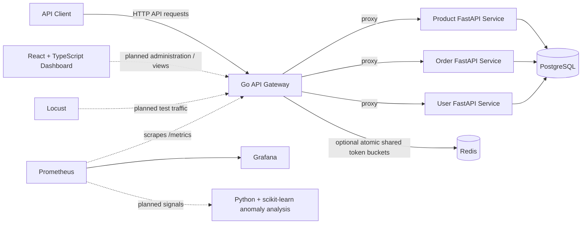
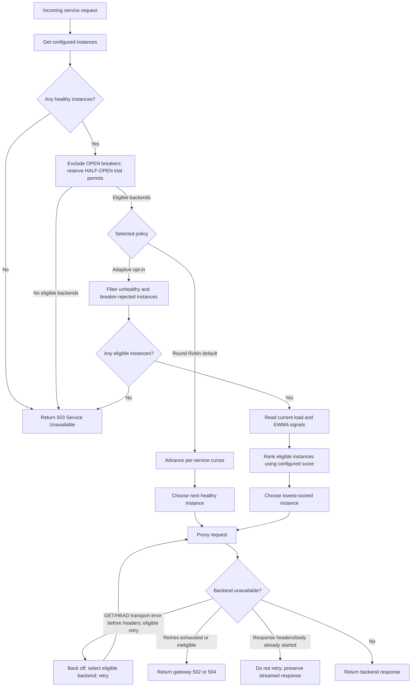
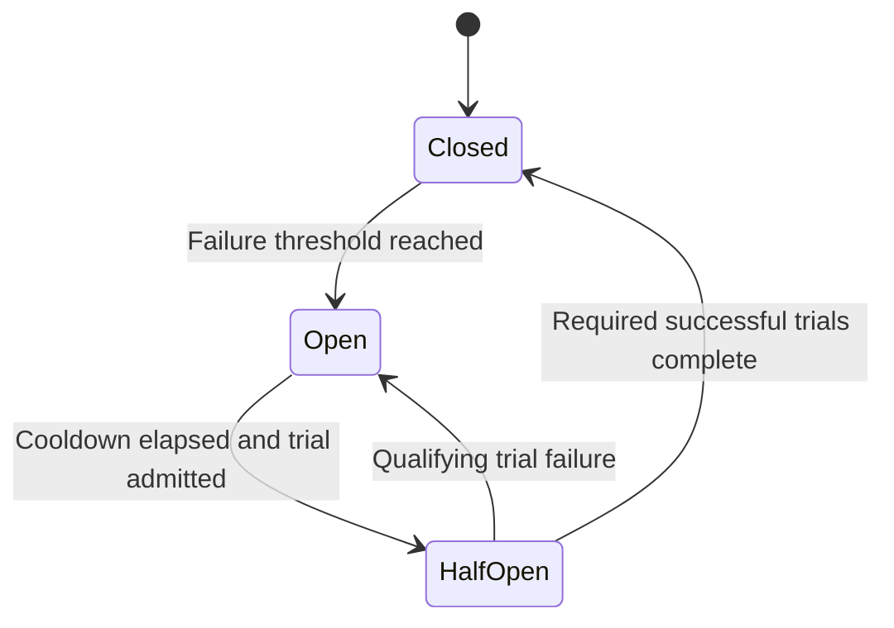

# IntelliGate Proposed Architecture

**Status:** Phase 1 implements the Go HTTP reverse proxy and three FastAPI services. Phase 2A adds per-service Round Robin pools; Phase 2B adds active health probes and selects only healthy instances; Phase 3A adds configurable upstream request timeouts; Phase 3B adds per-backend circuit breakers; Phase 3C adds bounded retries for eligible upstream transport failures; Phase 4A adds an in-memory per-client-IP token bucket; Phase 4B.1 adds API-key authentication; Phase 4B.2 adds role-based access control; Phase 5A adds optional Redis-backed shared token buckets; Phase 5B adds Prometheus instrumentation and a provisioned Grafana dashboard; Phase 6 adds opt-in adaptive routing. JWT/OAuth, distributed authentication, databases, and application containerization remain proposed.

## 1. High-level system architecture

The Go gateway is the public entry point for client API traffic. It proxies requests to configured Python FastAPI backend instances using Go's standard HTTP reverse-proxy capabilities and selects an instance using health- and breaker-aware Round Robin by default, or adaptive latency/load scoring when configured. Direct backend `/health` probes update eligibility. A separate metrics listener exposes bounded-cardinality Prometheus metrics; Prometheus and Grafana run in the optional `observability/` Compose stack while the gateway initially runs natively. Redis is implemented as an optional shared rate-limit store; PostgreSQL is designated for persistent application data and selected configuration. Locust, the application dashboard, and anomaly-detection component remain planned.



**Status note:** Gateway-to-service HTTP connections, API-key authentication, Round Robin selection, active health checks, configurable upstream request timeouts, per-backend circuit breakers, controlled retries, memory/Redis per-IP rate limiting, Prometheus metrics, and the Prometheus/Grafana monitoring stack are implemented. PostgreSQL, Locust, the application dashboard, and anomaly detection remain proposed. Only the monitoring tools are containerized; the gateway and services are run natively.

### Phase 1/4B.2 runtime configuration

| Component | Local address | Gateway route |
| --- | --- | --- |
| Gateway | `http://localhost:8080` | Entry point |
| Metrics listener | `http://localhost:9091/metrics` | Prometheus scrape endpoint, separate listener |
| Product Service | `http://localhost:8001` | `/api/v1/products` and descendants |
| Order Service | `http://localhost:8002` | `/api/v1/orders` and descendants |
| User Service | `http://localhost:8003` | `/api/v1/users` and descendants |

When the corresponding URL-list environment variable is unset, the gateway defaults to one backend per service at the listed address. Configure multiple backends using comma-separated full URLs in `PRODUCT_SERVICE_URLS`, `ORDER_SERVICE_URLS`, and `USER_SERVICE_URLS`. Additional port values are chosen by the local operator; the table shows existing defaults, not a required multi-instance port layout. The gateway keeps the incoming path and query string unchanged when proxying. Each service also exposes `GET /` and `GET /health` directly on its local port.

The gateway probes each configured backend's `/health` directly with GET requests every 5 seconds and a 2-second timeout. Initial probes run concurrently and complete before the gateway begins serving. Only direct 2xx responses count as healthy; redirects are not followed. An unavailable backend can continue to receive traffic until a subsequent failed probe completes.

Application proxy requests use `INTELLIGATE_UPSTREAM_TIMEOUT`, a positive Go duration parsed at startup. It defaults to `5s`; invalid, zero, or negative values stop startup with an error. The timeout bounds the upstream request using the incoming request context; health probes continue to use their separate 2-second timeout.

Circuit-breaker policy is global and applied independently to every configured backend. Startup accepts `INTELLIGATE_CIRCUIT_BREAKER_FAILURE_THRESHOLD` (`5`), `INTELLIGATE_CIRCUIT_BREAKER_OPEN_COOLDOWN` (`10s`), `INTELLIGATE_CIRCUIT_BREAKER_HALF_OPEN_MAX_REQUESTS` (`1`), and `INTELLIGATE_CIRCUIT_BREAKER_HALF_OPEN_SUCCESS_THRESHOLD` (`1`). All values must be positive; malformed or nonpositive values fail startup.

Rate limiting is enabled by default. `INTELLIGATE_RATE_LIMIT_STORE` selects `memory` (default) or `redis`; `INTELLIGATE_RATE_LIMIT_ENABLED=false` disables limiting. The default policy is 10 tokens per second with a burst capacity of 20, overridable through `INTELLIGATE_RATE_LIMIT_RATE` and `INTELLIGATE_RATE_LIMIT_BURST`. Enabled values must be finite and positive. The Redis connection uses `INTELLIGATE_REDIS_ADDR` (default `localhost:6379`), optional `INTELLIGATE_REDIS_PASSWORD`, and `INTELLIGATE_REDIS_DB` (default `0`). `INTELLIGATE_RATE_LIMIT_REDIS_FAILURE_MODE` accepts `closed` (default, return 503) or `open` (log a generic warning and allow requests). Redis mode performs a bounded startup ping and never falls back to memory. Client identity is the canonical IP parsed from `RemoteAddr`; `X-Forwarded-For` and `X-Real-IP` are ignored. Gateway `GET /health` is exempt. Idle buckets expire after 10 minutes; only memory mode runs the periodic cleanup loop.

API-key authentication is enabled by default. `INTELLIGATE_AUTH_ENABLED=false` explicitly disables authentication. Configure credentials using exactly one of `INTELLIGATE_API_KEY_ROLES` (a JSON object mapping keys to `admin`, `read`, or `write`) or legacy comma-separated `INTELLIGATE_API_KEYS`; setting both is a startup error. The legacy list remains compatible and assigns every key the `admin` role. Role JSON must be a non-empty object with unique, non-empty keys and recognized role names. Malformed JSON, duplicate/ambiguous keys, invalid entries, and unknown roles fail startup without exposing credential values. Surrounding key whitespace is trimmed.

The gateway protects `/api/v1` and all `/api/v1/*` paths, including future routes. `admin` and `write` allow GET, HEAD, POST, PUT, PATCH, and DELETE; `read` allows only GET and HEAD. Other methods are rejected with 403. Missing or invalid keys return 401; authenticated requests without method permission return 403. Only `GET /health` is public. Roles come only from the authenticated key and are stored in request context; client-supplied role headers/query parameters are not trusted. Do not put real keys in source-controlled configuration. For deployment, provide high-entropy keys through protected secret management and use TLS.

The metrics listener uses `INTELLIGATE_METRICS_LISTEN_ADDR` (default `:9091`) and serves only `GET /metrics`. It is a separate `http.Server`, outside API authentication, authorization, rate limiting, and request instrumentation. It binds and starts with the API listener and shuts down with it; startup/bind errors are reported. The metrics listener has bounded read, write, idle, and header timeouts. Its lack of API authentication is intentional for Prometheus scraping, so restrict port 9091 with host firewall and network controls.

## 2. Component responsibilities

### Gateway (Go)

Beyond the Phase 1 behavior below, the gateway is responsible for:

- Expose a public HTTP entry point and statically route the three service prefixes (implemented).
- Log each request method and path, without query parameters (implemented).
- Return `404 Not Found` for unmatched paths, `503 Service Unavailable` when no backend is eligible, and `502 Bad Gateway` when a selected backend cannot be reached (implemented).
- Authenticate protected clients and authorize API methods from the credential role before per-client rate limiting (implemented in Phases 4B.1/4B.2).
- Select a configured backend instance round-robin within each service pool (implemented in Phase 2A).
- Probe backend health and select only healthy instances (implemented in Phase 2B).
- Admit only healthy instances whose circuit breaker permits a request (implemented in Phase 3B).
- Select instances using adaptive EWMA latency/load scoring (implemented in Phase 6; opt-in).
- Bound upstream proxy requests using the configured timeout (implemented in Phase 3A); preserve 502 for ordinary proxy failures and return 504 when an upstream deadline expires before response headers.
- Gather HTTP request/status/duration, security-denial, rate-limit, backend-health/selection, breaker, and retry metrics (implemented in Phase 5B).
- Expose gateway `GET /health` and separate-listener Prometheus `GET /metrics` (implemented); readiness remains planned.
- Exclude unhealthy instances and restore them after a successful probe (implemented in Phase 2B).

The `proxy`, `router`, `balancer`, `health`, `circuitbreaker`, and `observability` packages under `gateway/internal/` are implemented. Instrumentation uses injected observers rather than changing routing policy.

### Backend microservices (Python + FastAPI)

- **Product Service:** Sample catalog GET endpoint implemented; broader catalog operations remain planned.
- **Order Service:** Sample orders GET endpoint implemented; order creation and retrieval remain planned.
- **User Service:** Sample users GET endpoint implemented; profile operations remain planned.

Each service will own its domain API. Service-level validation and persistence details remain to be designed with implementation. Backend services are not intended to replace gateway authentication and traffic policy.

### Redis and PostgreSQL

- **Redis:** Optional shared rate-limit state implemented in Phase 5A using `github.com/redis/go-redis/v9` and an atomic Lua token-bucket operation. Redis is not required in the default memory mode.
- **PostgreSQL:** Persistent application records and selected gateway/service configuration. Configuration ownership, schema, and migrations remain implementation decisions.

### Monitoring and supporting tools

- **Prometheus:** Scrape and retain gateway metrics.
- **Grafana:** Visualize Prometheus metrics through dashboards.
- **Locust:** Generate controlled, repeatable workloads.
- **React + TypeScript + Tailwind CSS:** Planned dashboard interface.
- **Python + scikit-learn:** Planned offline or otherwise explicitly scoped analysis of traffic signals; real-time integration is not yet decided.

## 3. Request lifecycle

The Phase 5B application request path is:

1. Receive an HTTP request at the API listener (default port 8080); the outer instrumentation wrapper records the completed request once, including middleware-generated responses and requests that trigger retries.
2. Log the method and path without query parameters or credentials.
3. Validate `X-API-Key` on `/api/v1` and `/api/v1/*`; return 401 for a missing or invalid key. Resolve the role from the key and attach it to the request context. `GET /health` is public.
4. Authorize the method for that role; return 403 if it is unsupported or not permitted. Client role headers and query parameters are ignored.
5. Consume a token from the configured memory or Redis client-IP bucket; return 429 with `Retry-After` if the bucket is exhausted, or 503 if Redis fails in `closed` mode. Redis errors in `open` mode produce a generic warning and allow the request. `GET /health` also bypasses this limiter.
6. Match the request path to one of the three service prefixes; return 404 if none matches.
7. Select the next healthy configured instance whose breaker admits a request; return 503 if none is eligible.
8. Proxy the request with its original path and query; eligible GET/HEAD transport failures may retry under the bounded Phase 3C policy.

Separately, the health checker probes every configured instance directly at `/health`. The gateway marks all instances unhealthy before the first probe cycle, completes that cycle before accepting application traffic, then starts periodic checks. Probe status changes update the corresponding selector; later successful probes restore eligibility.

The independent metrics listener serves `/metrics` from a dedicated Prometheus registry. It is not routed through the API handler or counted as a public API request. It exposes Go/process runtime collectors alongside IntelliGate metrics.

Adaptive backend selection is implemented as an opt-in policy. Instrumentation callbacks are bounded and non-sensitive; metrics do not affect routing outcomes.

The gateway applies the controlled retry policy described below after backend selection. It does not infer failures from downstream HTTP status codes.

### Upstream request timeout (implemented in Phase 3A)

`INTELLIGATE_UPSTREAM_TIMEOUT` accepts a positive Go duration such as `3s` or `1500ms`; if unset, the default is `5s`. Configuration is validated before backend startup. Each proxy request gets a timeout context derived from its incoming request context, so a client cancellation or earlier client deadline is preserved. The timeout cancels the upstream operation and does not hold a shared lock or block other proxy requests.

If the deadline expires before upstream response headers arrive, the gateway observes a `504 Gateway Timeout`; ordinary connection/proxy failures are observed as `502 Bad Gateway`. Eligible GET/HEAD requests may retry these pre-header errors under the Phase 3C policy below. If the deadline expires after response headers have been sent, the status cannot be changed and the response may be truncated. This keeps the existing streaming proxy behavior without buffering whole responses.

### Controlled upstream retries (implemented in Phase 3C)

The gateway allows at most two retries (three gateway-selected attempts total) for GET and HEAD requests. The backoff before the first retry is 100ms and before the second is 200ms. Each attempt goes through the normal health-aware selector and obtains a fresh circuit-breaker permit. The selector prefers an eligible backend not yet attempted; it can reuse an attempted backend only when no different eligible backend is available and the reused backend still passes health and breaker admission.

Only a transport/proxy error reported before response headers are committed is retryable. Completed upstream HTTP responses, including application 4xx/5xx and 502/503/504 responses, are forwarded without retry. A response-body streaming failure after headers is recorded by the breaker but is not retried. GET/HEAD requests with bodies are retried only when `GetBody` can replay the body.

The overall request retry deadline is derived from `(maximum attempts × INTELLIGATE_UPSTREAM_TIMEOUT) + total backoff`; with the default 5-second upstream timeout, the budget is 15.3 seconds. Incoming client cancellation or deadline stops retries without counting as an upstream failure. The upstream response body is streamed and is not buffered for retry.

```mermaid
sequenceDiagram
    participant C as Client
    participant G as Go Gateway
    participant R as Redis (optional)
    participant LB as Backend Pool / Router
    participant S as FastAPI Service
    participant P as Prometheus
    C->>G: Request
    G->>G: Capture one HTTP metric around the API handler
    G->>G: Log method/path; do not log credentials
    G->>G: Authenticate API key and resolve role unless GET /health
    G->>G: Authorize method for role
    G->>G: Consume memory or shared Redis token unless GET /health
    G->>G: Match route
    G->>LB: Select healthy instance (Round Robin implemented)
    LB-->>G: Selected backend
    G->>S: Proxy request
    S-->>G: Response
    G->>G: Record final status and duration
    G-->>C: Response
    P->>G: Scrape metrics endpoint
```

The metrics scrape is handled by the separate listener and does not pass through the API handler chain shown above. The depicted gateway-to-service lifecycle supports both the default Round Robin selector and the opt-in adaptive selector.

## 4. API key authentication and role authorization (implemented in Phases 4B.1/4B.2)

Every `/api/v1` and `/api/v1/*` request must carry one configured key in `X-API-Key`. Use one configuration source:

- `INTELLIGATE_API_KEY_ROLES`: a JSON object mapping each API key to `admin`, `read`, or `write`.
- `INTELLIGATE_API_KEYS`: the backward-compatible comma-separated key list. If the role map is absent, every legacy key is assigned `admin`.

Setting both variables is rejected as ambiguous. Startup rejects malformed JSON, empty/duplicate/ambiguous keys, and unknown roles. Keys are trimmed and retained as SHA-256 digests in the authenticator. Fixed-size digests are compared using `crypto/subtle`; credential values are not logged or returned in errors.

| Role | Allowed API methods |
| --- | --- |
| `admin` | GET, HEAD, POST, PUT, PATCH, DELETE |
| `read` | GET, HEAD |
| `write` | GET, HEAD, POST, PUT, PATCH, DELETE |

Unsupported methods (including OPTIONS, TRACE, and CONNECT) are rejected with `403 Forbidden`, even for `admin`. Missing or invalid credentials return `401 Unauthorized` with `{"error":"unauthorized"}`. A valid credential lacking method permission returns `403 Forbidden` with `{"error":"forbidden"}`. Roles are attached to a private request-context key after authentication; client-supplied headers or query parameters cannot assign roles. `X-API-Key`, `X-Role`, `X-User-Role`, and `X-Intelligate-Role` are removed before proxying. `GET /health` remains public.

Middleware order is request logging (method/path only) → authentication → authorization → rate limiting → gateway mux/router → health-aware selection, retry, and proxy handling. Unauthorized and forbidden requests therefore do not consume limiter tokens or contact backends.

This is process-local shared-key authentication, not JWT/OAuth or a distributed identity service. Legacy API keys remain unrestricted `admin` keys until migrated to an explicit role map. Configuration changes require a gateway restart; no key rotation/revocation service exists. Direct microservice ports bypass gateway authentication. Use high-entropy values, protected secret management, and TLS outside local development; do not commit real keys.

## 5. Rate-limiting architecture

The gateway keeps one token-bucket policy and supports two storage modes selected through `INTELLIGATE_RATE_LIMIT_STORE`:

- **Memory (default, Phase 4A):** floating-point tokens, time-based refill, and a mutex-protected per-client map. The default is 10 tokens/second and burst 20. Inactive buckets expire after 10 minutes and a cleanup loop runs every minute. Quotas are process-local.
- **Redis (Phase 5A):** each gateway instance calls an atomic Lua script to read, refill, consume, and update the same per-client bucket. Redis server `TIME` supplies the clock. The key prefix is IntelliGate-specific (`intelligate:ratelimit:v1`), with the canonical IP represented only by its stable SHA-256 digest. Redis applies a 10-minute idle TTL; no in-memory cleanup goroutine runs in this mode.

The Redis script stores integer microtokens (1,000,000 units per token), preserving fractional accounting without floating-point token state. Redis-mode rate and burst values are rounded to the nearest microtoken and must be representable from 0.000001 through 1000 tokens; the bound keeps intermediate integer arithmetic within Lua's exact-integer range. The default policy remains 10 tokens/second and burst 20 in either store.

`INTELLIGATE_RATE_LIMIT_ENABLED` defaults to `true`; setting it to `false` bypasses the limiter and preserves prior request behavior. `INTELLIGATE_RATE_LIMIT_RATE` and `INTELLIGATE_RATE_LIMIT_BURST` override positive finite values. Redis configuration is `INTELLIGATE_REDIS_ADDR` (default `localhost:6379`), optional `INTELLIGATE_REDIS_PASSWORD`, and `INTELLIGATE_REDIS_DB` (default `0`). Startup validates Redis settings and performs a bounded connectivity check; selecting Redis never silently falls back to memory. Redis operations have a bounded timeout and inherit request cancellation.

`INTELLIGATE_RATE_LIMIT_REDIS_FAILURE_MODE=closed` is the default: a Redis operation error returns HTTP 503 with `{"error":"rate limiter unavailable"}`. `open` logs a generic warning and allows the request. An outage is never reported as 429. Exhausted buckets return HTTP 429 with `{"error":"rate limit exceeded"}` and a positive, rounded-up `Retry-After` value in seconds. No global-quota headers are emitted. `GET /health` is exempt in both modes. Client identity is parsed from `RemoteAddr`; forwarded-IP headers are not trusted.

Use the same Redis address, database, rate, and burst configuration for every gateway instance that must share a quota. For a local two-process demonstration, `INTELLIGATE_LISTEN_ADDR` defaults to `:8080` and may be changed to another host/port such as `127.0.0.1:8081`. The Redis password is provided through the environment and is never logged. This implementation uses a single Redis address and does not configure TLS, Sentinel, or Cluster; production deployments need protected secret management, network isolation, and transport protection. Redis availability and persistence depend on the Redis deployment; no distributed authentication or per-key quotas are provided.

## 6. Routing and load balancing

### Health-aware routing (Round Robin default; adaptive option implemented in Phase 6)

Each service has its own selector over its configured backend handler list, health flags, breakers, and performance state. `INTELLIGATE_ROUTING_STRATEGY` selects `round_robin` (default) or `adaptive`; the strategy is configured consistently for Product, Order, and User. Both policies preserve health and circuit-breaker admission and return `503 Service Unavailable` when no backend is eligible. The selector preserves the Phase 2A all-healthy constructor default; gateway initialization explicitly sets every instance unhealthy before probing.

The health checker sends direct GET requests to each backend's `/health` endpoint. It runs the initial probes concurrently before the HTTP server starts, then probes periodically every 5 seconds with a 2-second client timeout. Only 2xx responses are healthy; redirects are not followed. Connection failures, timeouts, and other status codes mark an instance unhealthy. The next successful probe restores it to the round-robin pool. Health is based only on probe outcomes, not ordinary application responses.

If a backend fails after its last successful probe, eligible GET/HEAD requests may retry a bounded number of times through the same health- and breaker-aware selector. Other methods and completed upstream responses are not retried. Repeated qualifying failures open that backend's breaker; it is then excluded independently of health state. If no backend is eligible before the initial attempt, the route returns 503; after a retryable failure, exhaustion or lack of an eligible next backend returns the last gateway-observed 502/504. Gateway `GET /health` remains a process liveness check and returns 200 regardless of backend health or breaker state. `round_robin` retains its existing cursor behavior unchanged.

### Adaptive latency/load routing

The adaptive selector tracks each measured backend attempt, including retries, without holding the selector mutex during handler execution. It increments in-flight state before dispatch and decrements it when the complete attempt finishes, including response-body streaming. Response bodies are streamed without buffering. TTFB is measured from the upstream `RoundTrip` dispatch until response headers arrive. The TTFB is pending until the upstream response body completes successfully; only then is it added as a successful EWMA sample. A missing TTFB measurement, incomplete body, gateway attempt error, or client cancellation does not produce a sample. Complete HTTP 4xx and 5xx responses count as successful transport responses.

Successful TTFB samples are exponentially weighted per backend with:

`EWMA_new = EWMA_old + alpha × (sample_latency - EWMA_old)`

The first successful sample initializes EWMA directly. This follows the proxy/breaker transport-success definition: any complete upstream HTTP response, including an application 4xx/5xx, is a successful latency sample; gateway-generated transport failures, timeouts, incomplete body reads, and cancellations are not.

Configure `INTELLIGATE_ROUTING_STRATEGY` (`round_robin` by default, or `adaptive`), `INTELLIGATE_ADAPTIVE_EWMA_ALPHA` (default `0.2`, finite and valid `(0, 1]`), and `INTELLIGATE_ADAPTIVE_MIN_SAMPLES` (default `5`, positive integer). Invalid values prevent startup. Within each selector pass, cooldown status is ranked first: prefer eligible backends outside cooldown; if all candidates are cooling down, prefer earliest recovery. Among non-cooling candidates, until every currently eligible backend in that pass has reached the minimum successful sample count, selection prefers the eligible backend with the fewest samples. Ties rotate deterministically using the existing Round Robin cursor. Once all candidates meet the threshold, select the lowest score:

`score = EWMA latency × (1 + current in-flight requests)`

Equal scores use deterministic Round Robin tie-breaking. Retry selection first considers eligible backends not yet attempted in the current request; cooldown ranking is applied within that group before previously attempted candidates are considered. Health and breaker admission still apply; an open breaker or a saturated half-open breaker is skipped. Each consecutive upstream transport/body failure increases a per-process cooldown from 5 seconds to 10, then 20, capped at 30 seconds. A successful completed measured response clears the failure count and cooldown. Client cancellations and downstream disconnects do not penalize a backend.

Performance history is held in memory per gateway process and is lost at restart. Separate gateway instances do not share these estimates; adaptive selection is local to each process. The score is a simple heuristic, not a guarantee of globally optimal routing. A backend with no successful observations remains in exploration, and adaptive mode has no explicit sample-age decay.



The diagram shows active-health and breaker admission shared by the default Round Robin policy and the opt-in adaptive policy.

## 7. Adaptive routing metrics

Phase 6 adds `intelligate_backend_ewma_latency_seconds` (gauge), `intelligate_backend_in_flight_requests` (gauge), and `intelligate_backend_successful_samples_total` (counter), each labeled only by the existing bounded `service` and stable `backend_id`. These values describe one gateway process and initialize to zero for each configured backend. They do not expose URLs, client identities, or arbitrary request data.

## 8. Health monitoring and recovery (implemented in Phase 2B)

The gateway actively probes each configured backend's `/health` endpoint using GET every 5 seconds, with a 2-second timeout and no redirect following. Initial probes run concurrently before application traffic is served. A direct HTTP 2xx response marks the instance healthy; connection errors, timeouts, redirects, and non-2xx statuses mark it unhealthy. Periodic successful probes restore eligibility. Probe outcomes—not application request statuses—control health. All-unhealthy service pools return 503; a backend failure between probes retains the existing gateway error/retry behavior. No hysteresis, health-probe retries, or health metrics are implemented.

## 9. Circuit breaker (implemented in Phase 3B)

Each configured backend instance has an independent breaker; breaker state is separate from the selector's health flag. Round Robin admits only instances that are healthy and whose breaker returns a permit. OPEN instances and HALF-OPEN instances at their trial concurrency limit are skipped. The selector and breaker locks are held only while checking eligibility/reserving a permit, never while proxying. If no instance can be selected before the initial attempt, the gateway returns `503 Service Unavailable`; after a retryable failure, the retry policy returns the last gateway-observed 502/504 if no next instance can be admitted.

The defaults are 5 consecutive qualifying failures, a 10-second OPEN cooldown, one concurrent HALF-OPEN trial, and one successful trial required to close. Startup overrides are `INTELLIGATE_CIRCUIT_BREAKER_FAILURE_THRESHOLD`, `INTELLIGATE_CIRCUIT_BREAKER_OPEN_COOLDOWN`, `INTELLIGATE_CIRCUIT_BREAKER_HALF_OPEN_MAX_REQUESTS`, and `INTELLIGATE_CIRCUIT_BREAKER_HALF_OPEN_SUCCESS_THRESHOLD`. Each must be a positive integer or duration as appropriate.

The proxy observer records upstream transport/request errors and response-body transport errors as failures. Client cancellation abandons a permit rather than failing the backend. A completed upstream HTTP response counts as a transport success regardless of its status, including application 4xx/5xx; an application-generated 502 or 504 is not mistaken for a gateway proxy error. Gateway-generated 502 and 504 correspond to qualifying upstream failures. Each retry attempt obtains and completes its own permit before backoff; the permit's idempotent completion prevents the selector fallback from double-counting an attempt.

After cooldown, an application request may reserve a HALF-OPEN trial; health probes are not trials. A successful health probe updates only the health flag and cannot close an OPEN breaker. A successful complete trial closes after the configured success threshold; a failed trial reopens and restarts cooldown. Permit generations prevent late results from older requests from overriding a newer state transition. Abandoned/canceled trials release their slot without counting success or failure.



Only qualifying upstream transport failures affect the failure count; ordinary application status codes do not.

## 10. Prometheus and Grafana integration (implemented in Phase 5B)

The `gateway/internal/observability` package owns a dedicated Prometheus registry, collectors, bounded-label normalization, observer methods, and the HTTP instrumentation wrapper. `github.com/prometheus/client_golang` supplies the registry/collectors and `github.com/felixge/httpsnoop` wraps `ResponseWriter` while preserving streaming and optional interfaces. The API server stays on its configured address (default `:8080`); the independent metrics listener defaults to `:9091`, has bounded HTTP timeouts, and exposes `GET /metrics` only. Metrics-server startup/bind failure is reported; both servers are shut down gracefully together.

The custom metrics and labels are:

| Metric | Type | Labels |
| --- | --- | --- |
| `intelligate_http_requests_total` | Counter | `method`, `route`, `status` |
| `intelligate_http_request_duration_seconds` | Histogram | `method`, `route` |
| `intelligate_rate_limit_rejections_total` | Counter | `reason` (`exhausted`, `store_unavailable`) |
| `intelligate_security_denials_total` | Counter | `stage` (`authentication`, `authorization`), `status` (`401`, `403`) |
| `intelligate_backend_health` | Gauge | `service`, `backend_id` |
| `intelligate_backend_health_transitions_total` | Counter | `service`, `backend_id`, `state` (`healthy`, `unhealthy`) |
| `intelligate_backend_selections_total` | Counter | `service`, `backend_id`, `attempt` (`initial`, `retry`) |
| `intelligate_backend_selection_failures_total` | Counter | `service`, `reason` (`unhealthy`, `breaker`) |
| `intelligate_circuit_breaker_state` | One-hot Gauge | `service`, `backend_id`, `state` (`closed`, `open`, `half_open`) |
| `intelligate_circuit_breaker_transitions_total` | Counter | `service`, `backend_id`, `from`, `to` |
| `intelligate_upstream_retry_attempts_total` | Counter | `service`, `method` |
| `intelligate_upstream_retry_outcomes_total` | Counter | `service`, `outcome` (`response`, `transport_error`, `cancelled`, `exhausted`) |
| `intelligate_backend_ewma_latency_seconds` | Gauge | `service`, `backend_id` |
| `intelligate_backend_in_flight_requests` | Gauge | `service`, `backend_id` |
| `intelligate_backend_successful_samples_total` | Counter | `service`, `backend_id` |

Methods are normalized to known HTTP methods or `OTHER`; routes are normalized to `products`, `orders`, `users`, `health`, or `unmatched`. Backend IDs are stable service-and-index identifiers, never target URLs. HTTP status remains a numeric status label. Raw paths, query strings, client IPs, API keys, role names, and arbitrary errors are not labels. Request metrics count one incoming API request regardless of internal upstream attempts and capture the final gateway status, including 401, 403, 429, 502, 503, and 504. Histograms start at millisecond-scale buckets and extend based on the configured retry budget. Health and one-hot breaker gauges are initialized for configured backends; transition counters count each state-transition notification while generation guards prevent stale gauge writes.

Run the optional monitoring stack from the repository root with environment-provided Grafana credentials:

```powershell
$env:GRAFANA_ADMIN_USER = "intelligate-admin"
$env:GRAFANA_ADMIN_PASSWORD = "replace-with-a-strong-local-password"
docker compose -f observability\docker-compose.yml up -d
```

The gateway can run natively on Windows; Prometheus scrapes `host.docker.internal:9091` every five seconds. The Compose files publish Prometheus on localhost port 9090 and Grafana on localhost port 3000, persist both services in named volumes, and provision a Prometheus datasource and the IntelliGate Overview dashboard automatically. Grafana credentials are required from environment variables and are not committed. Stop containers with `docker compose -f observability\docker-compose.yml down`; this preserves named volumes.

Metrics are unauthenticated and may reveal aggregate operational behavior. Do not expose port 9091 publicly; apply host firewall/network restrictions. The default listener binds all interfaces, so deployments must explicitly scope the listen address or enforce network restrictions. No alert rules, TLS/authentication on the scrape endpoint, or application dashboard are included.

## 11. Traffic anomaly detection

A Python component using scikit-learn is planned to explore anomalies in aggregated traffic or latency signals. The input features, training data, model selection, evaluation criteria, deployment mode, and response to an alert are undecided. Anomaly detection will not be treated as an automated enforcement mechanism without validation and explicit design review.

## 12. Architectural decisions and open decisions

**Fixed decisions:** Go gateway; standard-library reverse-proxy capabilities; FastAPI services; per-service Round Robin default with opt-in adaptive routing; independent health, performance, and circuit-breaker state per backend; Redis-backed distributed rate-limit state; PostgreSQL for persistent records/configuration; Prometheus and Grafana; Locust.

**Open decisions:** Additional local backend port assignments; runtime pool reload; health flapping/hysteresis policy; future routing-policy changes beyond the implemented score and configurable EWMA parameters; auth key lifecycle and admin authorization; dashboard interaction; anomaly model and operation mode. Metrics and adaptive performance estimates are process-local observations; multi-gateway metric aggregation depends on Prometheus scraping each instance separately.
