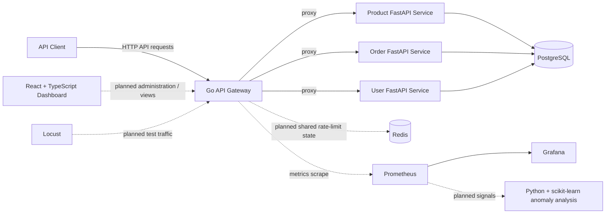
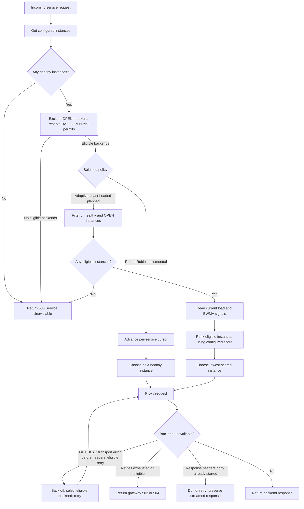
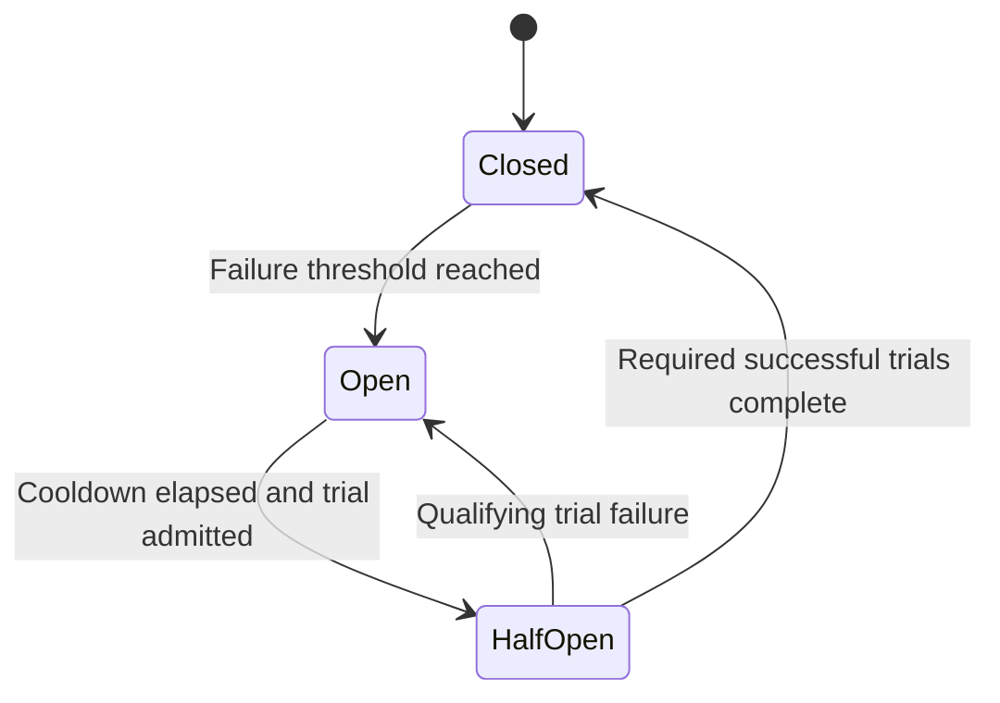

# IntelliGate Proposed Architecture

**Status:** Phase 1 implements the Go HTTP reverse proxy and three FastAPI services. Phase 2A adds per-service Round Robin pools; Phase 2B adds active health probes and selects only healthy instances; Phase 3A adds configurable upstream request timeouts; Phase 3B adds per-backend circuit breakers; Phase 3C adds bounded retries for eligible upstream transport failures; Phase 4A adds an in-memory per-client-IP token bucket; Phase 4B.1 adds API-key authentication for gateway API routes. JWT/role-based authorization, distributed rate limiting, adaptive routing, databases, monitoring, and the other integrations described below remain proposed.

## 1. High-level system architecture

The Go gateway is the public entry point for client API traffic. It proxies requests to configured Python FastAPI backend instances using Go's standard HTTP reverse-proxy capabilities and selects an instance round-robin from each service's healthy pool. Direct backend `/health` probes update eligibility. Future phases may add additional gateway policies and service-owned domain APIs. Redis is designated for distributed rate-limit state; PostgreSQL for persistent application data and selected configuration. Prometheus/Grafana, Locust, the dashboard, and anomaly-detection component remain planned.



**Status note:** Gateway-to-service HTTP connections, API-key authentication, Round Robin selection, active health checks, configurable upstream request timeouts, per-backend circuit breakers, controlled retries, and in-memory per-IP rate limiting are implemented. Redis, PostgreSQL, Prometheus, Grafana, Locust, dashboard, and anomaly-detection connections remain proposed. No containerized deployment is included.

### Phase 1/4B.1 runtime configuration

| Component | Local address | Gateway route |
| --- | --- | --- |
| Gateway | `http://localhost:8080` | Entry point |
| Product Service | `http://localhost:8001` | `/api/v1/products` and descendants |
| Order Service | `http://localhost:8002` | `/api/v1/orders` and descendants |
| User Service | `http://localhost:8003` | `/api/v1/users` and descendants |

When the corresponding URL-list environment variable is unset, the gateway defaults to one backend per service at the listed address. Configure multiple backends using comma-separated full URLs in `PRODUCT_SERVICE_URLS`, `ORDER_SERVICE_URLS`, and `USER_SERVICE_URLS`. Additional port values are chosen by the local operator; the table shows existing defaults, not a required multi-instance port layout. The gateway keeps the incoming path and query string unchanged when proxying. Each service also exposes `GET /` and `GET /health` directly on its local port.

The gateway probes each configured backend's `/health` directly with GET requests every 5 seconds and a 2-second timeout. Initial probes run concurrently and complete before the gateway begins serving. Only direct 2xx responses count as healthy; redirects are not followed. An unavailable backend can continue to receive traffic until a subsequent failed probe completes.

Application proxy requests use `INTELLIGATE_UPSTREAM_TIMEOUT`, a positive Go duration parsed at startup. It defaults to `5s`; invalid, zero, or negative values stop startup with an error. The timeout bounds the upstream request using the incoming request context; health probes continue to use their separate 2-second timeout.

Circuit-breaker policy is global and applied independently to every configured backend. Startup accepts `INTELLIGATE_CIRCUIT_BREAKER_FAILURE_THRESHOLD` (`5`), `INTELLIGATE_CIRCUIT_BREAKER_OPEN_COOLDOWN` (`10s`), `INTELLIGATE_CIRCUIT_BREAKER_HALF_OPEN_MAX_REQUESTS` (`1`), and `INTELLIGATE_CIRCUIT_BREAKER_HALF_OPEN_SUCCESS_THRESHOLD` (`1`). All values must be positive; malformed or nonpositive values fail startup.

The in-memory per-client token bucket is enabled by default. `INTELLIGATE_RATE_LIMIT_ENABLED=false` disables it. When enabled, `INTELLIGATE_RATE_LIMIT_RATE` defaults to 10 tokens per second and `INTELLIGATE_RATE_LIMIT_BURST` defaults to a capacity of 20 tokens; malformed, non-finite, zero, or negative values fail startup. Client identity is the canonical IP parsed from `RemoteAddr`; `X-Forwarded-For` and `X-Real-IP` are ignored. Gateway `GET /health` is exempt. Idle buckets expire after 10 minutes and a cleanup loop runs every minute. This quota is local to one gateway process; shared Redis state remains proposed.

API-key authentication is enabled by default. `INTELLIGATE_AUTH_ENABLED=false` explicitly disables it; when enabled, `INTELLIGATE_API_KEYS` is required and contains comma-separated keys. Surrounding whitespace is trimmed. Empty entries, empty configuration, and keys containing whitespace/control or non-ASCII characters fail startup. The gateway protects `/api/v1` and all `/api/v1/*` paths, including routes added in the future; only `GET /health` is public. Do not put real keys in source-controlled configuration. For deployment, provide high-entropy keys through protected secret management and use TLS.

## 2. Component responsibilities

### Gateway (Go)

Beyond the Phase 1 behavior below, the gateway is planned to:

- Expose a public HTTP entry point and statically route the three service prefixes (implemented).
- Log each request method and path, without query parameters (implemented).
- Return `404 Not Found` for unmatched paths, `503 Service Unavailable` when no backend is eligible, and `502 Bad Gateway` when a selected backend cannot be reached (implemented).
- Authenticate protected clients with an API key before per-client rate limiting (implemented in Phase 4B.1).
- Select a configured backend instance round-robin within each service pool (implemented in Phase 2A).
- Probe backend health and select only healthy instances (implemented in Phase 2B).
- Admit only healthy instances whose circuit breaker permits a request (implemented in Phase 3B).
- Select instances using an adaptive policy (planned; not implemented).
- Bound upstream proxy requests using the configured timeout (implemented in Phase 3A); preserve 502 for ordinary proxy failures and return 504 when an upstream deadline expires before response headers.
- Gather latency, request, health, and circuit-breaker metrics.
- Expose gateway `GET /health` (implemented); readiness and Prometheus metrics endpoints remain planned.
- Exclude unhealthy instances and restore them after a successful probe (implemented in Phase 2B).

The `proxy`, `router`, `balancer`, `health`, and `circuitbreaker` packages under `gateway/internal/` are implemented. The `middleware` and `metrics` directories remain planned boundaries.

### Backend microservices (Python + FastAPI)

- **Product Service:** Sample catalog GET endpoint implemented; broader catalog operations remain planned.
- **Order Service:** Sample orders GET endpoint implemented; order creation and retrieval remain planned.
- **User Service:** Sample users GET endpoint implemented; profile operations remain planned.

Each service will own its domain API. Service-level validation and persistence details remain to be designed with implementation. Backend services are not intended to replace gateway authentication and traffic policy.

### Redis and PostgreSQL

- **Redis:** Planned shared state for distributed token bucket rate limiting. The implemented Phase 4A limiter is in memory and does not require Redis.
- **PostgreSQL:** Persistent application records and selected gateway/service configuration. Configuration ownership, schema, and migrations remain implementation decisions.

### Monitoring and supporting tools

- **Prometheus:** Scrape and retain gateway metrics.
- **Grafana:** Visualize Prometheus metrics through dashboards.
- **Locust:** Generate controlled, repeatable workloads.
- **React + TypeScript + Tailwind CSS:** Planned dashboard interface.
- **Python + scikit-learn:** Planned offline or otherwise explicitly scoped analysis of traffic signals; real-time integration is not yet decided.

## 3. Request lifecycle

The Phase 4B.1 application request path is:

1. Receive an HTTP request at port 8080.
2. Log the method and path without query parameters or credentials.
3. Validate `X-API-Key` on `/api/v1` and `/api/v1/*`; return 401 for a missing or invalid key. The key is removed before proxying. `GET /health` is public.
4. Consume a token from the client's IP bucket; return 429 with `Retry-After` if no token is available. `GET /health` also bypasses this limiter.
5. Match the request path to one of the three service prefixes; return 404 if none matches.
6. Select the next healthy configured instance whose breaker admits a request; return 503 if none is eligible.
7. Proxy the request with its original path and query; eligible GET/HEAD transport failures may retry under the bounded Phase 3C policy.

Separately, the health checker probes every configured instance directly at `/health`. The gateway marks all instances unhealthy before the first probe cycle, completes that cycle before accepting application traffic, then starts periodic checks. Probe status changes update the corresponding selector; later successful probes restore eligibility.

Additional policies in the extended path remain proposed:

1. Add readiness and metrics endpoints with explicit access policies.
2. Obtain healthy backends and select an instance using an adaptive policy.
3. Record request outcome, latency, health, and circuit-breaker signals.

The gateway applies the controlled retry policy described below after backend selection. It does not infer failures from downstream HTTP status codes.

### Upstream request timeout (implemented in Phase 3A)

`INTELLIGATE_UPSTREAM_TIMEOUT` accepts a positive Go duration such as `3s` or `1500ms`; if unset, the default is `5s`. Configuration is validated before backend startup. Each proxy request gets a timeout context derived from its incoming request context, so a client cancellation or earlier client deadline is preserved. The timeout cancels the upstream operation and does not hold a shared lock or block other proxy requests.

If the deadline expires before upstream response headers arrive, the gateway observes a `504 Gateway Timeout`; ordinary connection/proxy failures are observed as `502 Bad Gateway`. Eligible GET/HEAD requests may retry these pre-header errors under the Phase 3C policy below. If the deadline expires after response headers have been sent, the status cannot be changed and the response may be truncated. This keeps the existing streaming proxy behavior without buffering whole responses.

### Controlled upstream retries (implemented in Phase 3C)

The gateway allows at most two retries (three gateway-selected attempts total) for GET and HEAD requests. The backoff before the first retry is 100ms and before the second is 200ms. Each attempt goes through the normal health-aware selector and obtains a fresh circuit-breaker permit. The selector prefers an eligible backend not yet attempted; it can reuse an attempted backend only when no different eligible backend is available and the reused backend still passes health and breaker admission.

Only a transport/proxy error reported before response headers are committed is retryable. Completed upstream HTTP responses, including application 4xx/5xx and 502/503/504 responses, are forwarded without retry. A response-body streaming failure after headers is recorded by the breaker but is not retried. GET/HEAD requests with bodies are retried only when `GetBody` can replay the body.

The overall request retry deadline is derived from `(maximum attempts × INTELLIGATE_UPSTREAM_TIMEOUT) + total backoff`; with the default 5-second upstream timeout, the budget is 15.3 seconds. Incoming client cancellation or deadline stops retries without counting as an upstream failure. The upstream response body is streamed and is not buffered for retry.

```mermaid
sequenceDiagram
    participant C as Client
    participant G as Go Gateway
    participant R as Redis (planned)
    participant LB as Backend Pool / Router
    participant S as FastAPI Service (planned)
    participant P as Prometheus (planned)
    C->>G: Request
    G->>G: Log method/path; do not log credentials
    G->>G: Validate API key unless GET /health
    G->>G: Consume process-local client token unless GET /health
    G->>G: Match route
    G->>LB: Select healthy instance (Round Robin implemented)
    LB-->>G: Selected backend
    G->>S: Proxy request
    S-->>G: Response
    G->>G: Record outcome and latency; update routing signals
    G-->>C: Response
    P->>G: Scrape metrics endpoint
```

The diagram represents intended later-phase interactions except for service-route matching, HTTP proxying, per-service Round Robin selection, active health checking, upstream timeouts, circuit-breaker admission, and bounded transport-error retries, which are implemented.

## 4. API key authentication flow (implemented in Phase 4B.1)

Every `/api/v1` and `/api/v1/*` request must carry one configured key in `X-API-Key`. The gateway accepts any configured key from comma-separated `INTELLIGATE_API_KEYS`, trims surrounding configuration whitespace, and compares SHA-256 digests with `crypto/subtle` constant-time comparison. Missing, invalid, or repeated header values return the same `401 Unauthorized` JSON response: `{"error":"unauthorized"}`. Keys are not included in logs or errors and are removed from the request before it reaches a backend.

Authentication is enabled by default. `INTELLIGATE_AUTH_ENABLED=false` is an explicit opt-out; otherwise missing or malformed `INTELLIGATE_API_KEYS` prevents startup. Gateway `GET /health` remains public and is not proxied. Middleware order is request logging (method/path only) → API-key authentication → rate limiting → gateway mux/router → health-aware selection, retry, and proxy handling. Thus an unauthorized request neither consumes a rate-limit token nor reaches backend selection.

This is shared-secret authentication only. Keys are process configuration, not distributed, and key rotation/revocation requires updating configuration and restarting the gateway. There are no users, roles, JWTs, or per-key quotas. Use high-entropy values, protected secret management, and TLS outside local development; do not commit real keys.

## 5. Rate-limiting architecture

### In-memory token bucket (implemented in Phase 4A)

The gateway uses floating-point token accounting with time-based refill, a default rate of 10 tokens per second, and a burst capacity of 20 tokens. Each accepted request consumes one token. Buckets are keyed by the canonical client IP parsed from the connection's `RemoteAddr`; forwarded-IP headers are not trusted. Bucket operations and cleanup share a short mutex, which is released before downstream routing or proxy execution. Inactive entries expire after 10 minutes; cleanup runs every minute.

When a request has insufficient tokens, the gateway returns HTTP 429 with `{"error":"rate limit exceeded"}` and a positive, rounded-up `Retry-After` value in seconds. No global-quota headers are emitted. `GET /health` is exempt. Configuration uses `INTELLIGATE_RATE_LIMIT_ENABLED` (default `true`), `INTELLIGATE_RATE_LIMIT_RATE` (default `10`), and `INTELLIGATE_RATE_LIMIT_BURST` (default `20`). Rate and burst must be finite positive numbers when enabled.

The limiter is process-local. Shared buckets across gateway instances using Redis, policy administration, and behavior for distributed-state failures remain future work.

## 6. Routing and load balancing

### Health-aware Round Robin (implemented in Phase 2B)

Each service has its own selector over its configured backend handler list and health flags. For each request, the selector locks briefly, scans from its cursor for the next healthy instance, advances after that selection, and unlocks before proxying. Health updates use the same mutex. If no instance is healthy, it returns `503 Service Unavailable`. The selector preserves the Phase 2A all-healthy constructor default; gateway initialization explicitly sets every instance unhealthy before probing.

The health checker sends direct GET requests to each backend's `/health` endpoint. It runs the initial probes concurrently before the HTTP server starts, then probes periodically every 5 seconds with a 2-second client timeout. Only 2xx responses are healthy; redirects are not followed. Connection failures, timeouts, and other status codes mark an instance unhealthy. The next successful probe restores it to the round-robin pool. Health is based only on probe outcomes, not ordinary application responses.

If a backend fails after its last successful probe, eligible GET/HEAD requests may retry a bounded number of times through the same health- and breaker-aware selector. Other methods and completed upstream responses are not retried. Repeated qualifying failures open that backend's breaker; it is then excluded independently of health state. If no backend is eligible before the initial attempt, the route returns 503; after a retryable failure, exhaustion or lack of an eligible next backend returns the last gateway-observed 502/504. Gateway `GET /health` remains a process liveness check and returns 200 regardless of backend health or breaker state.

### Adaptive Least-Loaded

The adaptive policy will select an eligible instance using a measured load signal rather than fixed rotation. It should account for current in-flight requests and latency signals, while ensuring stale latency measurements do not unfairly penalize a backend indefinitely. The actual scoring formula, coefficients, and tie-breaking policy remain open implementation decisions for a later phase. Measurements must be collected consistently to avoid giving either policy an unfair advantage.



The diagram shows active-health and breaker admission with the implemented Round Robin policy and a proposed adaptive policy. Adaptive scoring is not implemented.

## 7. EWMA latency tracking

The gateway is planned to maintain a per-instance exponentially weighted moving average of observed response latency. With a chosen smoothing factor `alpha` (where `0 < alpha <= 1`), a sample update is:

`EWMA_new = alpha * latency_sample + (1 - alpha) * EWMA_previous`

The initialization rule, alpha, treatment of timeouts/errors, observation window, and concurrency safety need to be specified and measured. EWMA is a routing signal, not a substitute for health state or a guarantee of future latency.

## 8. Health monitoring and recovery (implemented in Phase 2B)

The gateway actively probes each configured backend's `/health` endpoint using GET every 5 seconds, with a 2-second timeout and no redirect following. Initial probes run concurrently before application traffic is served. A direct HTTP 2xx response marks the instance healthy; connection errors, timeouts, redirects, and non-2xx statuses mark it unhealthy. Periodic successful probes restore eligibility. Probe outcomes—not application request statuses—control health. All-unhealthy service pools return 503; a backend failure between probes retains the existing gateway error/retry behavior. No hysteresis, health-probe retries, or health metrics are implemented.

## 9. Circuit breaker (implemented in Phase 3B)

Each configured backend instance has an independent breaker; breaker state is separate from the selector's health flag. Round Robin admits only instances that are healthy and whose breaker returns a permit. OPEN instances and HALF-OPEN instances at their trial concurrency limit are skipped. The selector and breaker locks are held only while checking eligibility/reserving a permit, never while proxying. If no instance can be selected before the initial attempt, the gateway returns `503 Service Unavailable`; after a retryable failure, the retry policy returns the last gateway-observed 502/504 if no next instance can be admitted.

The defaults are 5 consecutive qualifying failures, a 10-second OPEN cooldown, one concurrent HALF-OPEN trial, and one successful trial required to close. Startup overrides are `INTELLIGATE_CIRCUIT_BREAKER_FAILURE_THRESHOLD`, `INTELLIGATE_CIRCUIT_BREAKER_OPEN_COOLDOWN`, `INTELLIGATE_CIRCUIT_BREAKER_HALF_OPEN_MAX_REQUESTS`, and `INTELLIGATE_CIRCUIT_BREAKER_HALF_OPEN_SUCCESS_THRESHOLD`. Each must be a positive integer or duration as appropriate.

The proxy observer records upstream transport/request errors and response-body transport errors as failures. Client cancellation abandons a permit rather than failing the backend. A completed upstream HTTP response counts as a transport success regardless of its status, including application 4xx/5xx; an application-generated 502 or 504 is not mistaken for a gateway proxy error. Gateway-generated 502 and 504 correspond to qualifying upstream failures. Each retry attempt obtains and completes its own permit before backoff; the permit's idempotent completion prevents the selector fallback from double-counting an attempt.

After cooldown, an application request may reserve a HALF-OPEN trial; health probes are not trials. A successful health probe updates only the health flag and cannot close an OPEN breaker. A successful complete trial closes after the configured success threshold; a failed trial reopens and restarts cooldown. Permit generations prevent late results from older requests from overriding a newer state transition. Abandoned/canceled trials release their slot without counting success or failure.



Only qualifying upstream transport failures affect the failure count; ordinary application status codes do not.

## 10. Prometheus and Grafana integration

The gateway is planned to expose a Prometheus scrape endpoint with bounded-cardinality metrics for request counts, status classes, latency, rate-limit decisions, backend health, and circuit-breaker state. Avoid labels containing API keys, user identifiers, raw URLs, or other unbounded/sensitive values. Prometheus will scrape the gateway; Grafana will visualize selected series. Scrape configuration, dashboards, retention, and alert rules are not yet present.

## 11. Traffic anomaly detection

A Python component using scikit-learn is planned to explore anomalies in aggregated traffic or latency signals. The input features, training data, model selection, evaluation criteria, deployment mode, and response to an alert are undecided. Anomaly detection will not be treated as an automated enforcement mechanism without validation and explicit design review.

## 12. Architectural decisions and open decisions

**Fixed decisions:** Go gateway; standard-library reverse-proxy capabilities; FastAPI services; per-service Round Robin across configured backend URLs; independent health and circuit-breaker state per backend; Redis-backed distributed rate-limit state; PostgreSQL for persistent records/configuration; Prometheus and Grafana; Locust; future comparison with Adaptive Least-Loaded.

**Open decisions:** Additional local backend port assignments; runtime pool reload; health flapping/hysteresis policy; routing score and EWMA parameters; breaker metrics and policy overrides per service; Redis failure mode; auth key lifecycle and admin authorization; metrics names and cardinality; dashboard interaction; anomaly model and operation mode.
